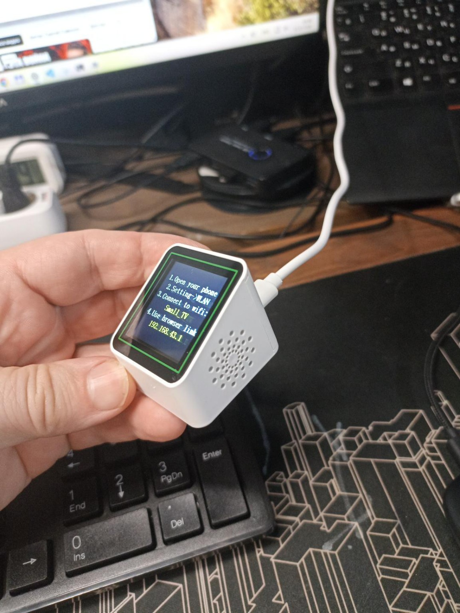
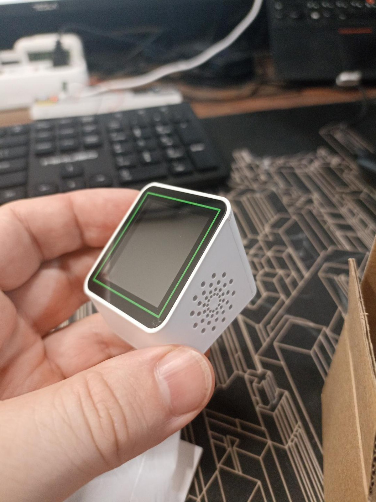
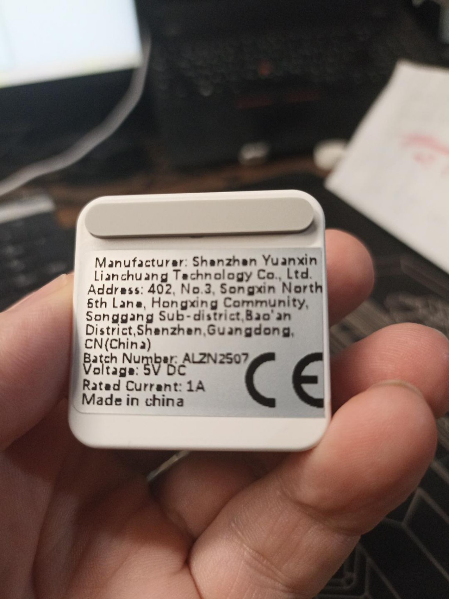
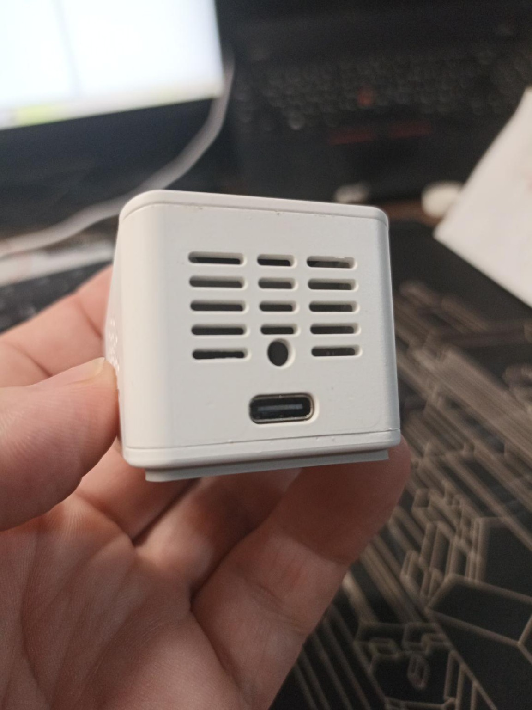

# Small TV ESP32-C2 smart clock

This directory documents the connected Small_TV desktop Wi-Fi clock and
preserves its original flash contents. The device has a white wedge-shaped
plastic enclosure, an inclined colour display with a green border, circular
perforations on one side, and a USB-C connector on the other.



## Device identification

The following details are visible in the owner's photographs supplied on
2026-10-10 in `smart_clock_chat_with_photos.zip`:

| Item | Observed on this device |
| --- | --- |
| Manufacturer | Shenzhen Yuanxin Lianchuang Technology Co., Ltd. |
| Batch number | `ALZN2507` |
| Labelled supply | 5 V DC, rated current 1 A |
| Connector | USB-C; serial data access was confirmed during the flash backup |
| Setup Wi-Fi network | `Small_TV` |
| Setup address | `http://192.168.43.1` |
| Enclosure | White plastic, inclined display, green display border and side perforations |

The 1 A value is the label rating, not a measured operating current. The
powered-on photograph shows instructions to connect a phone to `Small_TV`
and open the setup address in a browser; the setup page itself was not
tested during the backup.

The supplied conversation associates this enclosure with the Smart Clock
STV08. The photographed label does not show a model number or FCC ID, so
STV08 remains a reference identification rather than a confirmed model
code for this particular unit. Its dimensions have not been measured.

## Photographs

The four photographs below have all JPEG application metadata, comments
and trailing data removed, including any EXIF/GPS, XMP/IPTC, embedded
thumbnails and colour-profile metadata. The JPEG image data was kept
without recompression; decoded pixels and dimensions were verified
unchanged. The supplied copies had no EXIF/GPS tags; their JFIF and sRGB
ICC blocks were removed. Only the sanitized copies are included here.

| File | View |
| --- | --- |
| [01-front.jpg](images/01-front.jpg) | Display, green border and circular side perforations |
| [02-back-label.jpg](images/02-back-label.jpg) | Manufacturer, batch, supply rating and rubber strip |
| [03-usb-c-side.jpg](images/03-usb-c-side.jpg) | USB-C connector, slots and enclosure seams |
| [04-powered-on.jpg](images/04-powered-on.jpg) | Powered device and factory Wi-Fi setup instructions |





## Identified hardware

- Controller: ESP32-C2 / ESP8684H, silicon revision v2.0.
- CPU: single-core RISC-V, maximum frequency 120 MHz.
- Flash: 4 MiB (4,194,304 bytes), embedded; manufacturer ID `0xc8`,
  device ID `0x4016`. esptool identifies the flash vendor as GD.
- Crystal: 26 MHz.
- MAC address: `58:2a:bd:28:7d:54`.
- USB adapter: CH340, VID `1a86`, PID `7523`; capture port: COM8.
- On-chip SRAM: 272 KiB, including 16 KiB used for cache, according to the
  [Espressif ESP8684 datasheet](https://documentation.espressif.com/esp8684_datasheet_en.html).
  Free runtime RAM was not measured.

The ESP32-C2 supports 2.4 GHz Wi-Fi and Bluetooth LE. It has no additional
programmable ULP/LP core, no I2S peripheral and no built-in audio DAC. See
the [ESP8684 datasheet](https://documentation.espressif.com/esp8684_datasheet_en.html)
and the [ESP-IDF ULP support note](https://docs.espressif.com/projects/esp-idf/en/stable/esp32c2/api-reference/system/ulp.html).
An audio output for a YoRadio port would therefore need its own design;
no radio firmware or audio output has been tested on this unit.

## Display configuration recovered from the stock firmware

Static analysis of this device's archived dump on 2026-10-12 recovered
the ST7789 display routines and the following GPIO assignments. The
analysis used RISC-V disassembly and Ghidra decompilation, with structure
layouts checked against the firmware's ESP-IDF 5.5.4 headers.

| Display signal | Firmware configuration |
| --- | --- |
| SPI clock / SCK | GPIO4 |
| SPI data / MOSI | GPIO6 |
| Data / command | GPIO5; low for commands, high for data |
| Reset | GPIO1; low for 100 ms, then high for 100 ms |
| Chip select | No GPIO assigned (`spics_io_num = -1`) |
| Backlight | GPIO18, LEDC channel 0 / timer 0, 1 kHz, 13-bit PWM |
| MISO | Not configured (`miso_io_num = -1`) |

The display uses **hardware SPI2**, requested at **40 MHz, mode 3**, with
automatic DMA allocation. It is not driven by software bit-banging.
The drawing routines limit coordinates to 0..239 in both axes, establishing
a 240 x 240 software viewport. Initialization selects RGB565 (`0x3A: 0x55`),
RGB order without axis reversal (`0x36: 0x00`), and display inversion on
(`0x21`). These are ST7789-family settings; the firmware does not read a
controller ID, so the exact ST7789 suffix and panel part number remain
unverified.

Only the absence of a driven CS GPIO is established by the firmware;
the reported connection to ground needs a PCB check. The stock LEDC
configuration has `output_invert = 0`, and its brightness setter computes
`duty = level * 8191 / 1000`. Electrical backlight polarity should therefore
be checked on this unit rather than copied from another board's settings.

See [the firmware analysis report](analysis/README.md) for code addresses,
decompiled routines, peripheral checks and the GPIO availability table.

## GPIOs available for extensions

No external-device assignment was found in the stock application for
**GPIO0, GPIO2, GPIO3, GPIO7 and GPIO10**. These are candidates for an
extension, subject to checking the PCB traces and accessible pads; GPIO7
also has a JTAG alternative function.

GPIO8 and GPIO9 have no identified application use but are boot strapping
pins. GPIO19/RX and GPIO20/TX are reserved for UART0 and the USB-UART
bridge. GPIO11..17 are dedicated to in-package flash on this ESP8684H.
The remaining GPIO1, GPIO4, GPIO5, GPIO6 and GPIO18 serve the display.

The peripheral audit found no additional external sensor, button input,
RTC, SD card, touch controller or audio-output initialization. This does
not exclude dormant hardware; weather data is requested from an Internet
service, not evidence of a local weather sensor.

## External board references

A [first-hand ESP32-C2 weather-clock teardown by J0k3r2k1](https://community.home-assistant.io/t/installing-esphome-on-new-smart-weather-clock-wifi-weather-station-display/1006172)
reports an ST7789V SPI display, 240 x 240 pixels, 4 MB flash and a 26 MHz
crystal. The memory and crystal match our serial diagnostics. The
[smalltv-mod ESP32-C2 hardware page](https://giovi321.github.io/smalltv-mod/getting-started/hardware/#smalltv-esp32-c2--esp8684)
also describes a 1.54-inch panel, a CH340C USB-UART bridge and an
AMS1117-3.3 regulator.

The reported SCK, MOSI, D/C, reset and backlight GPIO numbers match the
stock firmware. Both references use SPI mode 3. Their RGB/BGR and backlight
polarity settings differ from, or are not established by, our firmware
configuration above. The display diagonal, exact CH340 package, regulator
marking and physical wiring have not been checked on this device's PCB.

J0k3r2k1's teardown describes two screws hidden under a rubber strip,
after which the board and display slide out together. Our photograph
shows a similar strip, but the fasteners and opening method have not
been confirmed here. The side perforations alone do not establish that
there is a speaker; speaker, amplifier, battery and microphone presence
remain unverified.

The [teardown author's repository](https://github.com/J0k3r2k1/Smart-weather-clock)
contains another unit's stock backup. Our own verified dump below is the
restoration reference for this device. Similar-looking SmallTV products
also use ESP8266 or classic ESP32 boards, so their firmware and pinouts
do not establish compatibility with this ESP32-C2 unit.

## Image and settings storage

The stock firmware uses fixed flash areas for five 100 KiB JPEG photo
slots, five 200 KiB custom animation containers and an application
settings sector. Web pages are embedded in the application. No SPIFFS,
LittleFS, SimpleFS or FAT filesystem was identified. These areas are
already included in the full flash backup; see the
[storage layout report](analysis/storage.md) for offsets and evidence.
The [extracted image inventory](assets/README.md) includes a visual overview,
the five photos, five animated GIF previews, weather icons and status
graphics recovered from this snapshot. Exported images have source
metadata removed; the flash backup remains unchanged.

## Local copy of the firmware web interface

[The local site](local_site/README.md) serves the three recovered HTML
pages with a stateful emulator of their HTTP API. Run
`Small_TV/local_site/start.ps1` in PowerShell, then open
`http://127.0.0.1:8765/`. Settings, photo previews and image uploads work
locally; Wi-Fi connection and restart operations update simulated state.
The recovered pages and API behavior were checked in the browser and
with integration tests covering all 34 registered firmware routes.

## Reconstructed standalone firmware

[`src/`](src/README.md) contains the modular ESP32-C2 ESP-IDF reconstruction,
with descriptive names and an original-address symbol map. The broader
176-function export is organized into 16 reference modules; the executable
C implementation uses real SDK APIs. It builds the clock, display/backlight,
settings, image playback/upload, Wi-Fi/DNS, SNTP, weather and recovered HTTP
interface. Build artifacts are saved under
[`firmware/development/small-tv-esp32c2-reconstructed`](../firmware/development/small-tv-esp32c2-reconstructed).
Build and host tests are verified; the reconstructed firmware has not been
tested on the physical device. OTA is absent. See the source README for
the memory layout, compatibility differences and build instructions.

## Security review

The [static security audit](analysis/security/README.md) found no clear
malware indicators in the reviewed application paths. It did find
unauthenticated HTTP management, an open setup access point, plaintext
weather requests and unsafe DNS/image-transfer buffer handling. This is
not a complete proof of firmware safety; no live exploit or traffic test
was performed. The report includes decompiled handlers and instruction
evidence. The archived dump was preserved unchanged.

## Original firmware backup

Complete flash snapshot read from the connected device on 2026-10-10 at
16:42:40 UTC (18:42:40 Europe/Budapest).

### Files and verification

- `full-flash.bin`: all flash bytes from address `0x000000` through `0x3fffff`,
  including firmware, partition data and any saved device settings.
- `full-flash.bin.sha256`: SHA-256 checksum of the complete binary.
- `manifest.json`: capture details and verification result.

SHA-256:

```text
5321a6b9016a8fc8335958193b4ab182e0d9ea85cfc3363063f120080c1844f4
```

esptool 5.2.0 read the snapshot at 460800 baud. A subsequent `verify-flash`
operation against the connected device succeeded with a matching digest.
The archived copy was also checked against the original size and SHA-256.
No flash was written or erased. An application reset was issued after the
capture; application startup was not independently verified.

The binary is stored with Git LFS. Run `git lfs pull` after cloning to obtain
the complete backup file.

## Evidence provenance

Device appearance and label details above come from the owner's four
photographs. Controller, revision, flash, crystal and USB adapter details
come from the serial diagnostics recorded in `manifest.json`. Display
configuration and firmware GPIO use come from static analysis of our
own dump. Physical teardown details are attributed to external projects
and remain unverified on this unit. The conversation in the supplied ZIP
was used as a list of leads, not as independently verified hardware
documentation.
