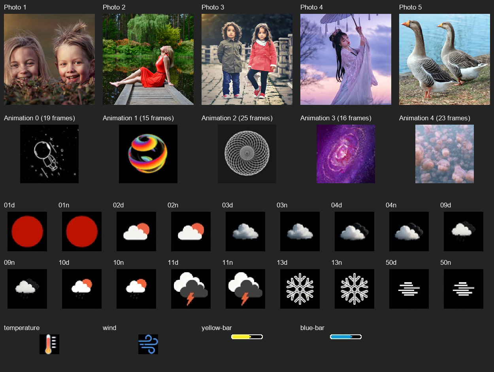
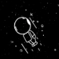
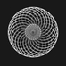
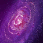

# Images recovered from the Small_TV firmware

These assets were decoded from the verified `../full-flash.bin` snapshot
on 2026-10-12. The backup itself was not changed. Flash offsets and hashes
for every extracted image/frame are recorded in [manifest.json](manifest.json).

## Five photos

All five JPEG images are 240 x 240 pixels. Slot capacity is 100 KiB, but
the encoded images have the smaller lengths listed below.

| Slot | Content | Flash offset | Original JPEG bytes | Export |
| --- | --- | --- | --- | --- |
| 1 | Two smiling children looking over plants | `0x200000` | 69,583 | [photo-1.jpg](photos/photo-1.jpg) |
| 2 | Woman in a red dress sitting on a wooden waterside walkway | `0x219000` | 100,527 | [photo-2.jpg](photos/photo-2.jpg) |
| 3 | Two children standing on a paved path | `0x232000` | 87,758 | [photo-3.jpg](photos/photo-3.jpg) |
| 4 | Woman in a pale dress holding an umbrella | `0x24B000` | 66,457 | [photo-4.jpg](photos/photo-4.jpg) |
| 5 | Two grey geese beside water | `0x264000` | 85,709 | [photo-5.jpg](photos/photo-5.jpg) |

## Five animations

Each animation has 74 x 74 pixel JPEG frames in a custom container.
The 98 frames are exported separately without recompression, alongside
standard GIF previews. The previews use an assumed 100 ms per frame
and GIF palette conversion; their timing is not a measured device rate.

| Index | Content | Flash offset | Frames | GIF preview |
| --- | --- | --- | --- | --- |
| 0 | White outline astronaut against a starry black background | `0x27D000` | 19 | [Astronaut](animations/animation-0/preview.gif) |
| 1 | Multicoloured sphere on black | `0x2AF000` | 15 | [Sphere](animations/animation-1/preview.gif) |
| 2 | White circular geometric pattern | `0x2E1000` | 25 | [Geometric pattern](animations/animation-2/preview.gif) |
| 3 | Purple spiral galaxy | `0x313000` | 16 | [Galaxy](animations/animation-3/preview.gif) |
| 4 | Pink flowers | `0x345000` | 23 | [Flowers](animations/animation-4/preview.gif) |

## Weather and status graphics

There are 18 BMP weather icons, each 60 x 60 pixels and 10,854 bytes.
Their fixed slots are 15 KiB apart, starting at `0x377000`. They are
exported as PNGs under `weather/`, retaining the decoded pixels. The
firmware maps the OpenWeatherMap icon-code strings to these addresses:

| Codes | Displayed graphic |
| --- | --- |
| `01d`, `01n` | Red sun disc |
| `02d`, `02n` | Sun behind a cloud |
| `03d`, `03n` | Cloud |
| `04d`, `04n` | Several clouds |
| `09d`, `09n` | Rain cloud |
| `10d`, `10n` | Sun, cloud and rain |
| `11d`, `11n` | Thunderstorm |
| `13d`, `13n` | Snowflake |
| `50d`, `50n` | Horizontal mist/fog lines |

The four additional JPEG status graphics are:

| Graphic | Flash offset | Dimensions | Export |
| --- | --- | --- | --- |
| Thermometer | `0x3BA800` | 25 x 25 | [temperature.jpg](status/temperature.jpg) |
| Wind symbol | `0x3BE400` | 25 x 25 | [wind.jpg](status/wind.jpg) |
| Yellow indicator bar | `0x3C2000` | 40 x 6 | [yellow-bar.jpg](status/yellow-bar.jpg) |
| Blue indicator bar | `0x3C5C00` | 40 x 6 | [blue-bar.jpg](status/blue-bar.jpg) |

## Extraction and privacy

Run `python Small_TV/analysis/extract_assets.py` with Python and Pillow to
recreate these exports. The extractor rejects a dump with a different
size or SHA-256. It parses JPEG segment lengths, so embedded EXIF
thumbnails are not mistaken for the end of the outer JPEG image.

Every exported JPEG has all APP/COM metadata removed, including EXIF,
XMP, ICC, comments and thumbnails. The thermometer and wind source JPEGs
contain such metadata; the exported copies omit it. Their decoded RGB
pixels were compared with the original and are identical. The PNGs and
overview contain no copied source metadata. GIFs retain only the
animation information needed for their previews. The original binary
remains the byte-exact restoration reference.

Validation covered all 107 exported JPEGs (5 photos, 98 frames and
4 status graphics), all 18 BMP-to-PNG conversions, all GIF frames and
the overview's visual layout. See the [storage layout](../analysis/storage.md)
for the surrounding flash regions.
