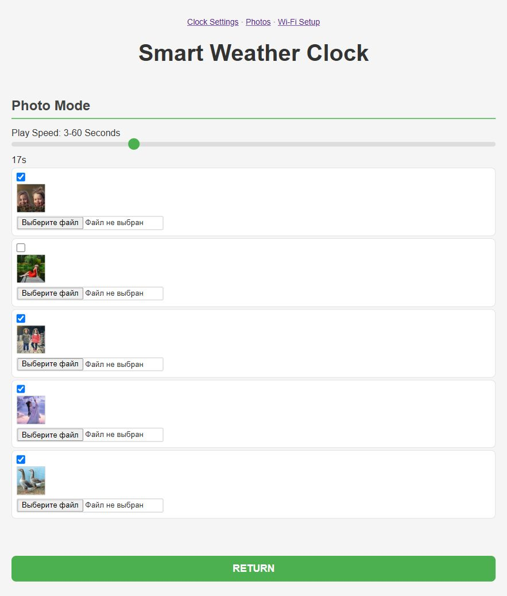

# Local Small_TV firmware web interface

The three original HTML/CSS/JavaScript pages recovered from this device's
flash run against a small local Python HTTP server. The normal settings
and photo-transfer API uses the same 34 route names, JSON fields, form
fields and response formats identified in the firmware. No frontend
framework, package installation or Internet connection is required.

The recovered setup/legacy settings scan lists share `wifi_network.js` for
network labels. It preserves signed RSSI in dBm, including a numeric zero,
and omits units for missing or nonnumeric measurements. This `FIXED_FACTORY`
correction removes the original `Math.abs` sign error; SSID option values remain
unchanged. Regenerate both pages with `extract_pages.py` after editing the module.
`src/tests/wifi_scan_test.mjs` executes their actual scan callbacks with synthetic
HTTP/DOM boundaries; the legacy settings control is supplied only for that test.

## Start and stop

From the repository root in PowerShell:

```powershell
.\Small_TV\local_site\start.ps1
```

The script starts a hidden background process and prints its URL:
`http://127.0.0.1:8765/`. It locates the bundled Python runtime on this
machine, or an installed Python/Windows Python launcher. Python 3.10 or
newer is required. Use `-Port 8766` if the default port is occupied.

To stop that process:

```powershell
.\Small_TV\local_site\stop.ps1
```

Alternatively, run the server in a terminal and stop it with Ctrl+C:

```text
python Small_TV/local_site/server.py
```

The server listens only on `127.0.0.1`. It is the delivered local app,
so leave it running while using the pages. It does not access the board
or its serial port, change the computer's Wi-Fi configuration, fetch
weather, or contact NTP servers. Wi-Fi connection and restart actions
update simulated device state. The Wi-Fi list contains three explicitly
named demonstration networks. The original Conversion Tool button still
opens the external ezgif website when clicked.

## Pages and behavior

| URL | Page |
| --- | --- |
| `/` | Wi-Fi setup initially; settings after a simulated connection |
| `/setup` | Original Wi-Fi setup page |
| `/settings` | Original city, clock, brightness, colour, animation and theme controls |
| `/photo` | Original photo controls, five previews, upload and playback interval |

The city, toggle states, selected GIF/theme/date format, brightness,
colours, image switches and display interval persist across page and
server restarts. RGB colours are quantized through RGB565, as in the
firmware; a chosen `#123456`, for example, reads back as `#103452`.
Initial values follow the recovered firmware's validated defaults.
The working brightness slider spans the actual 0..100% API range, including
the default 100%. Temperature and wind toggles are captioned according to the
factory values (`tempUnit=1` is Fahrenheit; `mileDisplay=1` is km/h). The
unsupported browser-time toggle is disabled and explains that network time
is used. Its API field remains available for raw-settings compatibility.

The initial photo previews use the five recovered, metadata-free JPEGs.
The working browser opens a crop dialog before uploading. Drag inside the
square to move it, drag any corner to shrink/enlarge it, or use the
horizontal/vertical position sliders and 1× to 4× zoom. Square proportions
remain fixed for the LCD. Confirming
resamples the selected area to 240 x 240 and encodes it as JPEG; Cancel or
Escape leaves the saved photo untouched. Transparent pixels become white.
JavaScript removes all APP/COM metadata, including Canvas ICC profiles, before
transferring the JPEG in 4 KiB multipart chunks. The
server validates the transfer, tolerates retries of the same chunk,
checks its final length and JPEG dimensions, removes APP/COM metadata,
and saves the result only when the upload is complete. A subsequent page
load downloads the saved image in chunks, as the firmware page does.

`photo_upload.js` supplies the upload function embedded by `extract_pages.py`.
It waits for each acknowledged write before sending the next block. Successful
blocks need no additional 50 ms sleep. Up to five attempts retain increasing
backoff between retries; the final failed attempt reports its error immediately.
The transfer checks execute the actual generated page script with held replies,
exact multipart bytes and retry/error cases. See
[the upload pacing evidence](../qemu/parity/photo-upload-waits-checks.md).

Local state, uploaded pictures, logs and the process ID are held under
`.runtime/`, which is ignored by Git. The state file can contain values
entered into Wi-Fi and advanced settings; it is not served as a public
file or committed. The original flash dump and recovered stock assets
are never written by this server. `server.py --reset` starts with default
settings and the original photo selection; earlier upload files are left
in the runtime directory but are no longer selected.

## Source fidelity and small browser fixes

- `source/` preserves the original document bytes from the recorded flash
  offsets, through each closing `</html>` tag. These bytes use GBK/GB18030,
  despite their UTF-8 meta tags. Git preserves their byte representation.
- `pages/` contains working UTF-8 copies. Their CSS and active firmware
  controls are retained. A small page navigation bar was added.
- The original C-string reads include a few non-document bytes after
  `</html>`; those are recorded in `pages-manifest.json` and omitted.
- JavaScript references to commented-out Wi-Fi/night/advanced controls
  are guarded against missing elements. Those controls remain hidden,
  matching the captured firmware's active page.
- Missing Wi-Fi controls do not trigger a background scan. Clock switches
  remain disabled until actual settings load; an error is shown instead of
  inventing checked defaults. The native HTTP server permits six simultaneous
  sessions for the visible settings requests.
- The duplicated setup response function is corrected so HTTP errors are
  handled, and successful setup returns to the local root page instead
  of navigating to `about:blank`.
- Original comments, including older references to ESP8266, are kept as
  source material and do not describe the actual ESP32-C2 hardware.

This is an HTTP/UI emulator, not execution of the RISC-V binary or a
simulation of the LCD pixels. Hidden night/advanced API endpoints are
implemented, but inactive or unsupported firmware features such as
application OTA are not enabled. The server reproduces normal user
operations; malformed requests are rejected instead of reproducing
the firmware's memory-safety defects. Stock photo lengths reflect the
cleaned JPEGs actually served, which omit the originals' metadata.

To regenerate the pages from the exact verified dump:

```text
python Small_TV/local_site/extract_pages.py
node Small_TV/local_site/check_scripts.mjs
```

The exporter checks the full dump SHA-256 and records original and local
page hashes in `pages-manifest.json`. Its source locations and contracts
come from the [storage report](../analysis/storage.md) and
[decompiled HTTP handlers](../analysis/security/security-decompiled.c).

## Verification

```text
python Small_TV/local_site/test_server.py
```

Four integration tests exercise all 34 registered firmware routes,
settings persistence, setup/restart transitions, a complete photo upload
with a repeated chunk, chunk downloads, and rejection of invalid requests
without state changes. They use temporary state beneath `.runtime/tests/`
and do not modify stock assets.

Browser verification on 2026-10-12 covered setup, selection of GIF/theme/
date format, brightness, RGB565 colour round-trip, temperature units,
city submission, reload persistence, all five photo previews, photo
switches, playback interval and uploading a 1152 x 1536 picture cropped
to a metadata-free 240 x 240 JPEG. Settings and photo pages had no captured
JavaScript warnings/errors. Preview timing of the recovered animation
assets is unrelated to this HTTP emulator.


