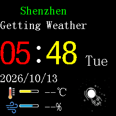
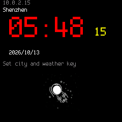
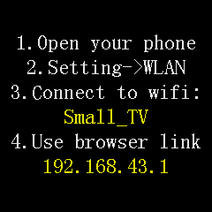
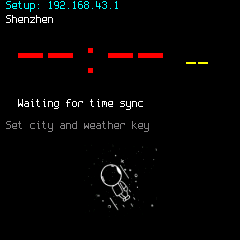

# Small TV QEMU validation

The [current factory-UI comparison checkpoint](parity/README.md) contains the
restored fonts/layouts and five scene comparisons. Work was paused at the user's
request; complete behavioral identity and the C-port assistant remain unfinished.

The latest [modular profiles and board compatibility checks](modular/README.md)
cover shared SPI/SD, configurable GPIO, CYD and C3 OLED regressions. Historical
clock/offline evidence below remains available for comparison.

The experimental `esp32c2` machine in `C:\Work\QEMU-ESP32`, branch
`codex/esp32c2-small-tv`, runs both applications with a 240×240 ST7789 and an
isolated Wi-Fi network. Tested networking model: `ae70de5e72`.
[clock-validation.json](clock-validation.json) records the binary hash and
captures. See QEMU's `README-small-tv-esp32c2.md` for build and GDB instructions.

## Wi-Fi and synchronization

| Component | Verified behavior |
|---|---|
| Virtual AP | Open `yoRadio-QEMU`, channel 1; guest driver performs authentication and association |
| Transport | C2 MAC/DMA and interrupts, shared 802.11 frontend; SLIRP DHCP assigns `10.0.2.15` |
| Local services | ARP, DNS, UDP NTP; firmware time-server names resolve to `10.0.2.2` |
| Time source | Current host UTC, sent in regular NTP responses |
| Guest clock | Both applications accept SNTP and store the epoch offset in RTC STORE2/3 |
| Internet | SLIRP `restrict=on`; other DNS names, including weather, receive NXDOMAIN |

Both applications passed **45-second headless runs**, LCD-content checks,
watchdog/panic checks and reset/reboot checks. The reconstruction additionally
passed association, station DHCP and animation checks. The NTP check reads the
RTC offset and compares it with the server timestamp in the same virtual time
scale; the displayed clock alone is not the evidence. The final binary also
passed the existing C3 production firmware's separate 20-second boot/OLED test.

- [Factory report](original-clock-report.json) and [UART log](original-clock-uart.log)
- [Reconstructed report](reconstructed-clock-report.json) and [UART log](reconstructed-clock-uart.log)
- [C3 regression](c3-network-regression.json)

| Factory application | Reconstructed application |
|---|---|
|  |  |

Screenshots come from a separate headless run with the same final binary and
settings. Each is a single actual framebuffer capture, selected between SPI
redraws. The factory displays `Getting Weather` because weather cannot resolve;
the reconstruction uses an empty key and displays `Set city and weather key`.

## Flash and virtual time

Application/bootloader instructions and assets are unchanged. The launcher copies
the archive, clears working NVS at `0x9000..0xefff` and seeds synthetic settings.
Factory settings occupy the raw sector at `0x3e7000`; the reconstruction uses
`small_tv/configuration` in NVS. Owner credentials, calibration identity and
weather keys are excluded. The factory receives a nonempty `disabled` key
sentinel to prevent fallback to its compiled vendor key. Source hashes remain
unchanged; no physical board was accessed and no OTA was added.

Fixed instruction-count time uses `-icount shift=3,align=off,sleep=on`.
Watchdogs remain enabled. Automatic clock adaptation and the former host-clock
launch mode produced interrupt watchdog panics; final checks use the stable
fixed mode. Under emulator load, virtual seconds may lag wall seconds. NTP sets
current time at synchronization; long runs can subsequently drift relative to
the host. RF behavior, power consumption and cycle timing are not modeled.

The authorized SDL windows were closed at the user's request. Final network
checks and captures use `-Display none`, so prolonged SDL stability is not
established. All test VMs were stopped.

## Run or control

```powershell
Set-Location C:\Work\QEMU-ESP32
.\run-small-tv-esp32c2.ps1 -Firmware original -Display none
.\run-small-tv-esp32c2.ps1 -Firmware reconstructed -Display none
.\run-small-tv-esp32c2.ps1 -Firmware reconstructed -Action screenshot
.\run-small-tv-esp32c2.ps1 -Firmware reconstructed -Action status
.\run-small-tv-esp32c2.ps1 -Firmware reconstructed -Action reset
.\run-small-tv-esp32c2.ps1 -Firmware reconstructed -Action stop
.\test-small-tv-esp32c2.ps1 -TestSeconds 45
```

The default network profile is `clock`. Add `-Network offline` to launch and
control commands for earlier offline behavior. SDL is the default display.
Each profile/variant has a separate directory under `.cache/small-tv-c2/`.
Snapshot mode discards guest writes; `-Persistent` retains them in the working
copy. Original dump and firmware archive are never writable drives.

Reconstructed settings use the pinned ESP-IDF Python environment's official NVS
generator. Internet weather, HTTPS and host access to the guest web server are
outside these checks.

## Earlier offline evidence

[validation.json](validation.json), [factory report](original-report.json),
[reconstructed report](reconstructed-report.json), [wrapper report](wrapper-validation.json)
and [C3 report](c3-regression.json) belong to the model before C2 transport.
Both images passed 30-second boot/display and reset checks; the wrapper repeated
them for 10 seconds. Saved `*-smoke-uart.log` files belong to the shorter run.

| Earlier factory setup | Earlier reconstructed offline UI |
|---|---|
|  |  |

## C2 compatibility observations

- Genuine revision-2 ROM is 576 KiB with the correct DROM alias and ROM data
  templates. SRAM is 272 KiB including 16 KiB cache; C3 RTC RAM is absent.
- Fixed PMPADDR3–15 regions exist before ROM execution, and PMP resets cleanly.
  The 64-entry MMU has a different invalid bit/page-size register; both guests
  select 64 KiB pages.
- C2 has 43 IRQ sources, one GDMA channel pair and different RTC offsets.
  With 26 MHz XTAL, SYSTIMER is 10.4 MHz and APB is 40 MHz.
- SPI2 FIFO/DMA drives ST7789: SCK4, MOSI6, D/C5, Reset1, backlight18. LEDC duty
  represents average active-low brightness. `CS=-1` keeps the virtual LCD
  selected; physical CS wiring remains unconfirmed.
- Wi-Fi MAC base is `0x60047000`. RX reload/base/next/last offsets are
  `0x64/0x68/0x6c/0x70`; TX PLCP0 is `0xce8`, with 8-byte queue spacing. TX
  completion bits start at bit 16.
- Station-address filters start at `0x30/0x38`, BSSID filters at `0x00/0x08`.
  Radio frequency writes at `0x6004e8c4` update the AP receive channel. C2 RX
  metadata uses the C3 metadata layout.
- Analog calibration uses completion flags, not RF measurements.

Bluetooth, ADC, low-power modes, security, full machine checkpoints and
electrical GPIO/SPI timing remain outside validation. Specifications can be
checked against the [Espressif ESP8684 datasheet](https://documentation.espressif.com/esp8684_datasheet_en.html)
and C2 headers/ROM ELF in the pinned ESP-IDF source.
