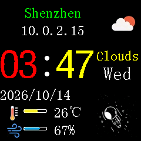
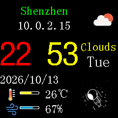
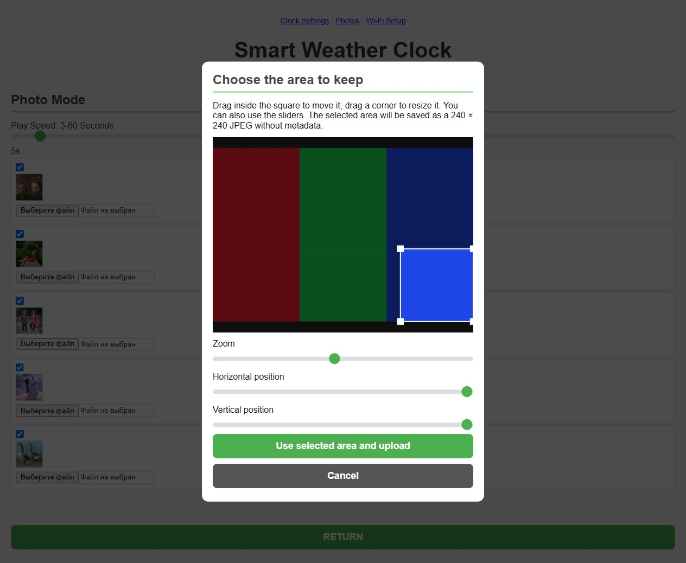

# Small TV QEMU validation

The [current factory-UI comparison checkpoint](parity/README.md) contains the
restored fonts/layouts and five scene comparisons. Reconstruction is active;
complete behavioral identity and the C-port assistant remain unfinished.

The current [device profile](profiles/README.md) lives in this repository at
`profiles/small-tv-c2.json`. It supplies hardware wiring, NTP/HTTP endpoints and
SSID data to the generic QEMU service compiler. Rebuild QEMU for the service
properties introduced in `f4322a8a8f`; our test launcher uses `ServicePort`.
Use `Small_TV/qemu/run.ps1` to select this profile and keep VM state under the
yoRadio `.build` directory.

## Localhost HTTP and initial Wi-Fi setup

The launcher now exposes actual firmware HTTP through separate consecutive
loopback ports. For an explicit setup range:

```powershell
& .\Small_TV\qemu\run.ps1 -Network setup `
    -Firmware reconstructed -HttpBasePort 18080 -Persistent -Display none
```

| Browser address | Role |
|---|---|
| `http://127.0.0.1:18080` | Setup access point |
| `http://127.0.0.1:18081` | Station after Wi-Fi configuration |

Select the open **yoRadio-QEMU** network and leave its password empty. The
firmware saves credentials, reboots, receives DHCP and serves its working UI
at the second port. `-Action status -Network setup` lists the current mapping.
`-HttpBasePort 0` chooses a free block from 18080; several VMs get separate
blocks. `-HttpBasePort -1` disables forwarding. The default `clock` profile
starts directly in station mode and exposes one loopback HTTP port. Browser
access does not require knowing or assigning the virtual board's IP to the host.

[HTTP integration evidence](http-initial-setup-validation.json) checks both
firmware images' setup/configure/reboot/persistence and two simultaneous station
VMs with independent settings. Native scan is mandatory. The original's flow
uses manual SSID entry: its unchanged `/scan` can dereference `malloc(0)` when
there are no results (`0x4200f484`), so this path is explicitly excluded rather
than counted as passing. Its `/configure` also depends on the compact JSON
emitted by its browser; native parsing accepts whitespace normally.

The native setup keeps an idle STA alongside the AP, allowing ESP-IDF scan;
STA does not connect before credentials are saved. This agrees with the factory
`initialize_wifi_softap_at_4200d06e` selecting APSTA. QEMU fixes keep the virtual
AP client's MAC consistent through DHCP and distinguish RX LAST from RX NEXT.
External scan responses select the configured STA MAC slot. These checks use
real guest TCP/HTTP and SDK code, with an open synthetic Wi-Fi network; browser
JavaScript, RF/WPA encryption and Internet weather are still separate checks.

Run the [complete functional suite](../src/tests/README.md) to include these
network checks with machine-code comparisons and screen regressions.

The latest [modular profiles and board compatibility checks](modular/README.md)
cover shared SPI/SD, configurable GPIO, CYD and C3 OLED regressions. Historical
clock/offline evidence below remains available for comparison.

The experimental `esp32c2` machine in `C:\Work\QEMU-ESP32`, branch
`codex/esp32c2-small-tv`, runs both applications with a 240×240 ST7789 and an
isolated Wi-Fi network. Tested networking model: `ae70de5e72`.
[clock-validation.json](clock-validation.json) records the binary hash and
captures. See QEMU's `README-small-tv-esp32c2.md` for build and GDB instructions.

## Wi-Fi and synchronization

The [weather differential report](weather-http-validation.json) adds an opt-in
loopback HTTP fixture. `-WeatherPort <port>` directs `api.openweathermap.org` to
the virtual subnet's `.100:80`; SLIRP guestfwd carries the real guest TCP stream
to `127.0.0.1:<port>`. DHCP advertises the isolated DNS replacement when the
restricted backend supplies no DNS option. Other external names remain blocked.
The local DNS option is also advertised in ordinary clock/setup profiles so
named SNTP servers work after AP-to-STA reboot. The setup test requires a DNS
reply for a named time server, as well as an accepted NTP response.
The test server is started/stopped by `Small_TV/src/tests/weather_qemu.py`.
It checks parsed values and four nonblank LCD regions for positive and negative
weather, HTTP failure/retry, and refresh through the firmware's real web API.
Neither application nor runtime RAM/PC is patched.

Live factory responses exposed eight hyphenated wind direction labels missed
by the earlier reconstruction. Their literal bytes at `0x3c0c3a68..0x3c0c3afc`
and the half-open sector comparisons now agree. The factory also parses valid
JSON from an HTTP 503 response: `0x42010988` checks the transport result but
does not check HTTP status before the event parser at `0x4200fccc`. The native
program deliberately rejects that vendor bug and retains its previous cache.

| Factory with synthetic weather | Reconstruction with the same response |
|---|---|
|  |  |

These are actual metadata-free panel captures. The four weather regions are
checked for equality; live clock/animation phase is not a whole-frame parity gate.

| Component | Verified behavior |
|---|---|
| Virtual AP | Open `yoRadio-QEMU`, channel 1; guest driver performs authentication and association |
| Transport | C2 MAC/DMA and interrupts, shared 802.11 frontend; SLIRP DHCP assigns `10.0.2.15` |
| Local services | ARP, DNS, UDP NTP; firmware time-server names resolve to `10.0.2.2` |
| Time source | Current host UTC, sent in regular NTP responses |
| Guest clock | Both applications accept SNTP and store the epoch offset in RTC STORE2/3 |
| Internet | SLIRP `restrict=on`; weather is blocked by default, or served by the explicit local fixture |

Both applications passed **45-second headless runs**, LCD-content checks,
watchdog/panic checks and reset/reboot checks. The reconstruction additionally
passed association, station DHCP and animation checks. The NTP check reads the
RTC offset and compares it with the server timestamp in the same virtual time
scale; the displayed clock alone is not the evidence. The final binary also
passed the existing C3 production firmware's separate 20-second boot/OLED test.

- [Factory report](original-clock-report.json) and [UART log](original-clock-uart.log)
- [Reconstructed report](reconstructed-clock-report.json) and [UART log](reconstructed-clock-uart.log)
- [C3 regression](c3-network-regression.json)

| Factory application | Reconstructed application |
|---|---|
|  |  |

Screenshots come from a separate headless run with the same final binary and
settings. Each is a single actual framebuffer capture, selected between SPI
redraws. The factory displays `Getting Weather` because weather cannot resolve;
the historical reconstruction used an empty key and displayed `Set city and weather key`.
Current fixtures seed the same synthetic `disabled` key in both applications.

## Flash and virtual time

Application/bootloader instructions and assets are unchanged. The launcher copies
the archive, clears working NVS at `0x9000..0xefff` and seeds synthetic settings.
Factory settings occupy the raw sector at `0x3e7000`; the reconstruction imports
that format and also stores `small_tv/configuration` in NVS. Owner credentials, calibration identity and
weather keys are excluded. The factory receives a nonempty `disabled` key
sentinel to prevent fallback to its compiled vendor key. Source hashes remain
unchanged; no physical board was accessed and no OTA was added.

Fixed instruction-count time uses `-icount shift=3,align=off,sleep=on`.
Watchdogs remain enabled. Automatic clock adaptation and the former host-clock
launch mode produced interrupt watchdog panics; final checks use the stable
fixed mode. Under emulator load, virtual seconds may lag wall seconds. NTP sets
current time at synchronization; long runs can subsequently drift relative to
the host. RF behavior, power consumption and cycle timing are not modeled.

The authorized SDL windows were closed at the user's request. Final network
checks and captures use `-Display none`, so prolonged SDL stability is not
established. All test VMs were stopped.

## Run or control

```powershell
Set-Location C:\Work\QEMU-ESP32
.\run-small-tv-esp32c2.ps1 -Firmware original -Display none
.\run-small-tv-esp32c2.ps1 -Firmware reconstructed -Display none
.\run-small-tv-esp32c2.ps1 -Firmware reconstructed -Action screenshot
.\run-small-tv-esp32c2.ps1 -Firmware reconstructed -Action status
.\run-small-tv-esp32c2.ps1 -Firmware reconstructed -Action reset
.\run-small-tv-esp32c2.ps1 -Firmware reconstructed -Action stop
.\test-small-tv-esp32c2.ps1 -TestSeconds 45
```

The default network profile is `clock`. Add `-Network offline` to launch and
control commands for earlier offline behavior. SDL is the default display.
Each profile/variant has a separate directory under `.cache/small-tv-c2/`.
Snapshot mode discards guest writes; `-Persistent` retains them in the working
copy. Original dump and firmware archive are never writable drives.

Current launchers seed a sanitized raw settings sector without invoking an NVS
generator. Localhost guest web access and synthetic weather have dedicated
checks above; Internet weather and HTTPS remain outside those checks.

## Browser photo and settings regression

[browser-regression.json](browser-regression.json) binds an actual browser run
to the current reconstructed application, frontend inputs and installed QEMU.
Dragging a corner shrinks/enlarges the square; the selected part of a synthetic
960×640 PNG is resampled to 240×240, cleaned by JavaScript and uploaded through
the native start/chunk/finish API. Guest JPEG headers/pixels are checked, and
Cancel/Escape leave its hash unchanged. Five previews decode after reload.
Clock flags, 0%/100% brightness and RGB565 colours are also checked against
guest HTTP replies. This is focused browser evidence, not complete UI or
physical-device acceptance.



## Earlier offline evidence

[validation.json](validation.json), [factory report](original-report.json),
[reconstructed report](reconstructed-report.json), [wrapper report](wrapper-validation.json)
and [C3 report](c3-regression.json) belong to the model before C2 transport.
Both images passed 30-second boot/display and reset checks; the wrapper repeated
them for 10 seconds. Saved `*-smoke-uart.log` files belong to the shorter run.

| Earlier factory setup | Earlier reconstructed offline UI |
|---|---|
|  |  |

## C2 compatibility observations

- Genuine revision-2 ROM is 576 KiB with the correct DROM alias and ROM data
  templates. SRAM is 272 KiB including 16 KiB cache; C3 RTC RAM is absent.
- Fixed PMPADDR3–15 regions exist before ROM execution, and PMP resets cleanly.
  The 64-entry MMU has a different invalid bit/page-size register; both guests
  select 64 KiB pages.
- C2 has 43 IRQ sources, one GDMA channel pair and different RTC offsets.
  With 26 MHz XTAL, SYSTIMER is 10.4 MHz and APB is 40 MHz.
- SPI2 FIFO/DMA drives ST7789: SCK4, MOSI6, D/C5, Reset1, backlight18. LEDC duty
  represents average active-low brightness. `CS=-1` keeps the virtual LCD
  selected; physical CS wiring remains unconfirmed.
- Wi-Fi MAC base is `0x60047000`. RX reload/base/next/last offsets are
  `0x64/0x68/0x6c/0x70`; TX PLCP0 is `0xce8`, with 8-byte queue spacing. TX
  completion bits start at bit 16.
- Station-address filters start at `0x30/0x38`, BSSID filters at `0x00/0x08`.
  Radio frequency writes at `0x6004e8c4` update the AP receive channel. C2 RX
  metadata uses the C3 metadata layout.
- Analog calibration uses completion flags, not RF measurements.

Bluetooth, ADC, low-power modes, security, full machine checkpoints and
electrical GPIO/SPI timing remain outside validation. Specifications can be
checked against the [Espressif ESP8684 datasheet](https://documentation.espressif.com/esp8684_datasheet_en.html)
and C2 headers/ROM ELF in the pinned ESP-IDF source.
