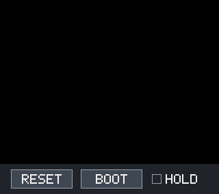
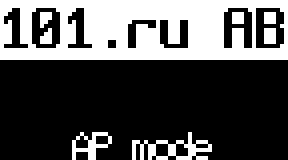
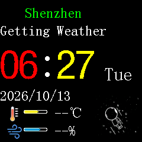
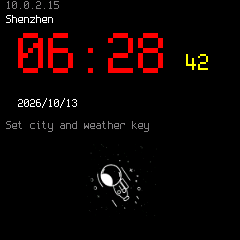

# Modular board profiles and compatibility checks

The QEMU workspace is `C:\Work\QEMU-ESP32`. Its `README-modular-esp.md`
documents the profile schema, launchers, buses, and regression commands.
`configs/boards/*.json` now creates real peripheral modules. The guest must
configure matching GPIO matrix or IO_MUX routes. Profiles do not modify guest
instructions.

| SoC | External SPI controllers | I2C controllers |
|---|---|---|
| ESP32-C2 | SPI2 | I2C0, 16-byte FIFO |
| ESP32-C3 | SPI2 | I2C0, 32-byte FIFO |
| ESP32 | SPI2 / HSPI and SPI3 / VSPI | I2C0, I2C1 |

SPI0/SPI1 remain reserved for flash/cache. The supplied module examples are
ST7789, SSD1306, and SPI SD. Other compiled SSI/I2C models can use the sockets;
a new controller still needs a QEMU device implementation.

SPI profiles select SCK/MOSI/MISO, independent CS GPIOs, D/C, reset, and
backlight. Devices can share data/clock pins and use separate CS. Incorrect
SCK/MOSI routes drop transactions; incorrect MISO does not return card data.
I2C modules reject a mismatched SCL/SDA output route. The emulator checks
transactions, not electrical waveforms or SPI bit banging. SD sector writes
use snapshots and leave the raw backing image unchanged.

`small-tv-c2.json` matches stock Small TV: SCK4/MOSI6/D-C5/reset1/backlight18,
active-low brightness, CS=-1. `small-tv-c2-sd.json` proposes LCD CS3 and
SD CS10/MISO2 on the same SPI2. The latter requires firmware changes and
physical LCD CS rewiring: neither the factory nor current reconstructed app
uses an SD driver or controls LCD CS3.

## Preserved board behavior

- Historical CYD `-M esp32,st7789=on,sdspi=on` retains its direct display and
  SD attachments, controls and UART keyboard integration. Modular mode is
  explicitly selected with `esp32,modular=on`.
- Historical `-M esp32c3` retains the original 72x40 SSD1306 attachment and
  GPIO behavior. A JSON profile explicitly selects
  `esp32c3,default-peripherals=off` and enables routing checks.
- Default Small TV wiring remains available with `-M esp32c2`.

## Saved verification

[validation.json](validation.json) combines the final module tests, unchanged
CYD/C3 firmware boot reports, Small TV boot/network reports, launcher check,
source revision and executable hashes. Separate JSON files contain detailed
checks. No firmware source images were changed.

- C2/C3: shared ST7789/SD SPI, hardware CS isolation, command/address phases,
  512-byte sector write/read, incorrect SCK/MISO rejection and snapshot integrity.
- ESP32: LCD on SPI2 and SD on SPI3; original CYD GPIO attachments also pass
  LCD pixel, SD sector and idle-high checks.
- C2/C3: SSD1306 on alternate GPIO8/9; an incorrect SCL route produces NACK.
- CYD: the same minimal build boots in the old and new QEMU executables.
  Captured console pixels match exactly. Its LCD region is black in both;
  nonzero pixels belong to the console controls. LCD/SD functionality is
  verified separately through MMIO. Existing flash/NVS/SPIFFS/Wi-Fi warnings
  limit this to boot/console compatibility, not the application screen or
  radio playback. An additional archived 0.9.723 image asserts during flash
  initialization; it is not included among successful guest boot checks.
- C3: unchanged production build boots with its original attachment and
  with `c3-oled.json`; both OLED framebuffers contain identical application content.
- Original/reconstructed Small TV: 60-second runs with `small-tv-c2.json`,
  display rendering, NTP reception and actual SNTP RTC offset, no panic, and a
  second boot after reset. Reconstruction also checks association, DHCP and animation.

The fixed instruction-count clock can lag wall time under host load. A
shorter loaded run reached DHCP before NTP; longer final runs cover
synchronization. No guest watchdog was disabled.

| CYD console (LCD blank in both versions) | Legacy C3 OLED |
|---|---|
|  |  |

| Factory Small TV with modular panel | Reconstructed Small TV |
|---|---|
|  |  |

PNG captures contain image headers and compressed pixels, with no EXIF,
location tags or device metadata. Validation VMs run headless and stop after
checks. No physical board, serial port or OTA endpoint was accessed.
Migration, RF, arbitrary peripheral IRQ wiring and cycle/power accuracy remain
unsupported.
