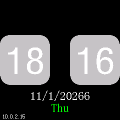
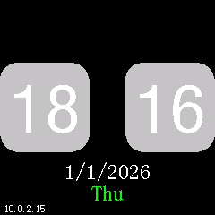

# Calendar update regression checks

The classic and simple clock now refresh the date after a change of year,
month or day, even when local hours, minutes, seconds and day-of-year are
unchanged. The simple clock also clears its entire date band before replacing
a longer date with a shorter one.

## Calendar jumps

The earlier C rollover correction compared only `tm_yday`, hours and minutes.
For example, jumping from 1 January 2025 to 1 January 2026 at the same local
time left the previous year and weekday visible. Another collision is
1 March 2024 → 2 March 2025: both have `tm_yday == 60`.

`calendar_changed` compares year, month and day as well as the existing
day-of-year signal. Both renderers use the same helper. It carries
`FIXED_RECONSTRUCTION` because the earlier attempt to repair rollover missed
these cases. The original classic outer gate at `0x4200b850` observes only
hour/minute/second; its inner date gate at `0x4200b0b2` observes minute/forced
refresh. The simple renderer `0x4200bd8c` relies on a minute event.

Two host scenarios additionally run the production clock task through an epoch
year jump at unchanged local h/m/s and day number. They require its retained
frame to match a fresh rendering, without injecting a minute timer event.

## Shorter simple dates

The simple date is centered at y=180. Replacing `10/13/2026` with `1/1/2026`
used to retain pixels from the old margins, producing `11/1/20266` in the
captured case below. The native renderer and the factory `0x4200bd8c` omitted
the background erase. `FIXED_FACTORY` identifies the deliberate correction:
clear x=0…239, y=180…203 before drawing the new centered date. Weekday and
IP footer bands remain outside that rectangle.

| Retained frame before correction | Clean rendering of the same final state |
|---|---|
|  |  |

These two pictures belong to the pre-fix native application
`d89542e62f823c0862c6e4d15b618ecc5e416ea5d87a9d21b7ae7d00cc591bd5`.
The [negative report](calendar-before.json) found 48 failing cases out of 96,
with up to 411 stale framebuffer pixels. The pictures are synthetic RV32
renderer captures, rather than photographs or a newer-image hardware result.

## Executed comparisons

`src/tests/calendar_oracle.py` checks both real RV32 renderers for eight successive
calendar states, all three date orders and both hour formats: 96 complete-frame
comparisons. Cases include year changes, repeated identical input, a leap-year
day-number collision and long-to-short dates with a normal minute change.

Each native retained frame must equal a freshly initialized native frame and
an explicitly corrected factory reference. That reference invalidates only the
previous-second cache and raises the minute-refresh flag on a calendar change.
In the simple theme it maps Sunday 0 to the factory-supported 7 and clears
the date band. Its original text, arithmetic and pixel instructions still run. The literal
factory's differences remain separately recorded; no pixels are masked.

The [current report](calendar-validation.json) binds the outcome to application,
source and ELF hashes. Controlled renderer inputs establish calendar handling;
they do not establish SNTP retry, timezone-library DST or physical timing behavior.
