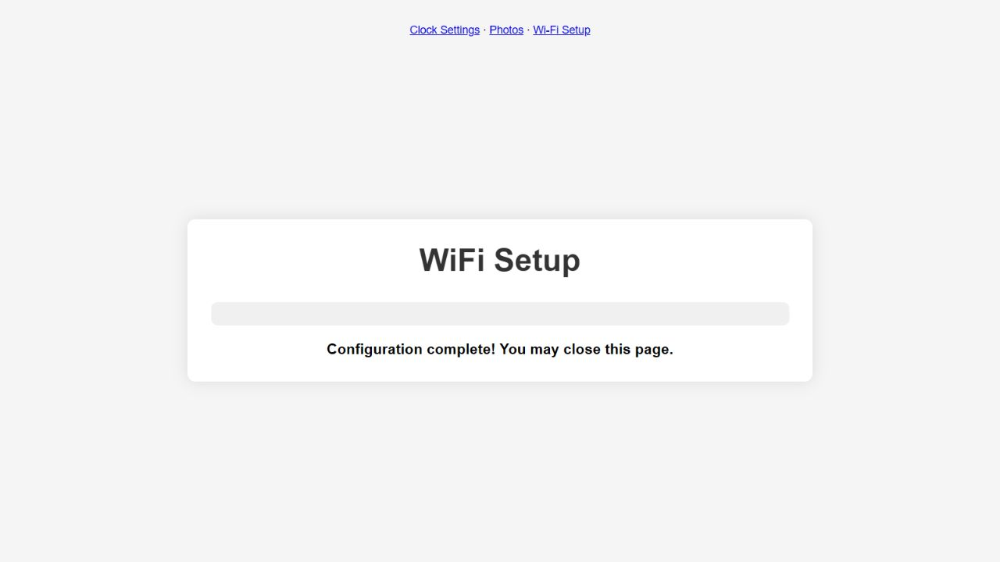

# Настоящая сеть с SSID `manual`

В заводском setup HTML по flash offset `0x026edc` обработчик формы проверяет
`ssid === "manual"`. Такое значение также может принадлежать настоящей найденной
сети: её выбор ошибочно вызывает prompt и может отправить другой SSID.
Источник — неизменённый дамп SHA-256
`5321a6b9016a8fc8335958193b4ab182e0d9ea85cfc3363063f120080c1844f4`.
Это ошибка JavaScript в HTML; адрес не является адресом машинной функции.

`isManualWifiSelection` вынесен в общий модуль `local_site/wifi_network.js` и
помечен `FIXED_FACTORY`. Два служебных fallback option получают
`data-manual-entry`; форма читает метку выбранного option. Настоящие SSID и
протокол `/configure` сохранены. Exporter проверяет уникальность замен и встраивает
модуль для автономной работы страницы. Повторная генерация всех страниц и manifest
даёт те же байты; фото-страница не меняется.

В `wifi_scan_test.mjs` выполняются реальные scan и submit callbacks с mock DOM,
HTTP и prompt. На заводской странице и предыдущей восстановленной странице
`real-ssid-manual` вызывает лишний prompt. Ещё шесть submit сценариев проходят:
обычный SSID, ручной ввод, ручной ввод строки `manual`, отмена, пустой ввод,
fallback после ошибки scan. После исправления проходят все 15 scan/setup случаев,
включая прежние восемь проверок RSSI. Mock POST фиксирует отправленный payload;
сам по себе он не подтверждает сохранение в устройстве.

Обычная и отладочная production сборки сохранены в development архивах этой
ветки. Source SHA `721e26bdeb12b4f31a94dae151fbf9d017b2f6e407e39b38f01f85171d7ab6ef`;
среди 59 production inputs относительно RSSI-кандидата изменён только
`generated/web_pages.c`, SDK config прежний. Обычный app `a5439306…`,
ELF `8485a233…`, 1 169 888 байт, свободно 366 112 байт в app-разделе.
Debug app `d1e7660d…`, ELF `eb4fdfb5…`, 1 230 384 байта. Host gate проходит:
C/API 3 950, platform 46 сценариев, frontend, integrity 6, timezone 9,
aggregation 14. Machine/full QEMU этого кандидата ещё не запускался.

В настоящем браузере открыта отдельная QEMU VM с копией профиля, где виртуальная
сеть называется `manual`. Выбранный option имеет value `manual`, подпись
`manual (-16dBm)` и не имеет ручной метки. Submit без пароля для открытой тестовой
сети показывает успешное сохранение и завершение настройки без prompt. После
рестарта через отдельный localhost STA port открывается Smart Weather Clock,
GET настроек завершается и элементы управления включаются. Read-only matched-ELF
наблюдение: connected=true, ap_active=false, DHCP `192.168.43.15`, SNTP=true;
расхождение SDK UTC с точным NTP reply 0,214516 с. Одна штатная перезагрузка:
два ROM boot, panic/watchdog нет. VM закрыта, исходные образы не менялись.

STA вкладка закрыта. Старый setup tab после исчезновения AP перестал отвечать
CDP; close/Escape не сработали, затем его generated error page блокирует browser
URL policy. Он оставлен временным, без deliverable/handoff, для штатной очистки
конца turn. Этот сбой инструмента не объявляется ошибкой firmware. Первый mock
run также выявил недостающий password node в тестовом DOM; после исправления
фикстуры отрицательный контроль оставил только реальную коллизию SSID.

Все identities и наблюдения: [manual-ssid-validation-20261017.json](manual-ssid-validation-20261017.json).
Это ограниченная проверка исправления. Физическая плата и 24h H10 этого app
не проверены; текущий длительный прогон относится к прежнему D78A7639.
