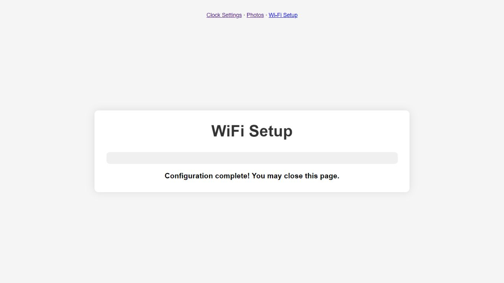

# Переход после настройки Wi-Fi

Заводские setup и legacy settings HTML по flash offsets `0x026edc`/`0x02963b`
после успешного сохранения показывают подтверждение и через 3 секунды переходят
на `about:blank`. Наш local exporter заменял эту цель на `/`. В firmware после
restart точка доступа выключается, поэтому такой reload обращался к прежнему
недоступному AP URL. Прежние отчёты относили последующие CDP/error-page проблемы
только к инструменту браузера; эта оценка была неполной: exporter внёс регрессию.

Глобальная подмена удалена; обе страницы сохраняют заводскую цель и 3-секундный
интервал. Entry comments completion handlers помечены `FIXED_RECONSTRUCTION`.
ReadResponse/status handling, signed RSSI и реальный SSID `manual` сохранены.
Фото-страница не меняется. Повторный export воспроизводит те же страницы.

`wifi_scan_test.mjs` выполняет реальные success callbacks и управляемые timers.
До исправления два случая (setup/settings target) дают `/` вместо `about:blank`;
остальные 16 проходят. На заводских страницах оба target случая проходят.
После исправления все 18 случаев проходят, включая failed-save без navigation
и скрытия формы. Полный frontend дополнительно проверяет JPEG/crop/resize/upload.

Реальный браузер на disposable QEMU ordinary app `922da963…` получил scan,
выбрал открытый `yoRadio-QEMU`, показал success alert и configuration complete,
затем автоматически перешёл на `about:blank`. Alert закрыт через dialog API;
вкладка закрылась штатно, browser inventory пуст. Screenshot сохранён до перехода.
SDK read-only matched-ELF observation подтверждает connected=true, AP=false,
DHCP `192.168.43.15`, SNTP=true и UTC error 0,471599 с. STA HTTP работает,
два ROM boots соответствуют одному штатному restart. VM остановлена,
исходные firmware images unchanged.

Первая диагностическая попытка ошибочно использовала clock-only helper,
ожидающий `10.0.2.15`: в setup-сети он истёк по своему 15 guest s пределу.
Это не отказ firmware; прямое чтение правильного setup/STA контекста прошло.

Ordinary/debug production builds сохранены в development архивах этой ветки.
Source `9d2367ebe11dc4097b8121eaac6d7bfed0c2bee9f5a0c48333ee288e9a669cbc`;
из 59 inputs меняется только `generated/web_pages.c`, SDK config прежний.
Host reduced native3950/platform46/frontend18/integrity6/timezone9/aggregation14
проходит. Полные identities: [setup-redirect-validation-20261017.json](setup-redirect-validation-20261017.json).
Новый full machine/QEMU и H10 ещё не выполнены. Физическая плата не использована.
